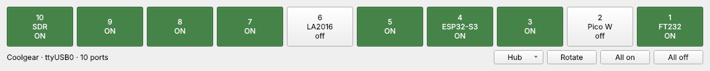
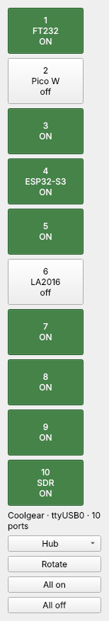

# usbhub-panel

A small desktop panel for switching USB hub ports on and off with a click: one button per port,
green when it has power. Built for an electronics bench, where power-cycling a hung dev board
shouldn't mean unplugging it.



It drives one of two command-line tools:

| Backend | Hubs | Tool |
|---|---|---|
| `coolgear` | Coolgear managed hubs (CG-10PU3MGD and siblings) | `cusbi`, Coolgear's Linux utility |
| `uhubctl` | Any hub with per-port power switching | [uhubctl](https://github.com/mvp/uhubctl) |

Coolgear ships a GUI for Windows and macOS only; on Linux there's just `cusbi`. uhubctl has no
GUI at all.

## Features

- **Click** a port to toggle its power. **Right-click** to power-cycle it or give it a name
  ("ESP32-S3", "logic analyzer"); names are kept between runs.
- **All on / All off** (All off asks first).
- **Rotate** between a row and a column. On Coolgear hubs the buttons match the front panel:
  port 10 on the left, or at the bottom when the panel stands on end.
- **Hub menu:** pick the hub when there's more than one. On Coolgear hubs also **save the
  current states as the power-on default** (stored in the hub) or **reset the hub**.
- Re-reads the ports every 2 seconds, so changes made from the command line show up too.
- With uhubctl, ports that feed another hub are locked, so one click can't cut a whole bank
  of sockets (see [Use](#use)).



## Status

| | Tested on hardware |
|---|---|
| `coolgear` backend (CG-10PU3MGD, firmware v01, Debian 13, KDE Plasma 6) | ✅ |
| `uhubctl` backend | not yet: reports welcome |
| Password-protected Coolgear hubs | not supported |

Reports from other hubs and desktops are welcome. Please open an issue with the hub model and
the output of `cusbi /Q` or `sudo uhubctl`.

## Install

Needs Python 3 and PyQt6. On Debian/Ubuntu:

```sh
sudo apt install python3-pyqt6
install -Dm 755 usbhub-panel ~/.local/bin/usbhub-panel
sed "s|@BIN@|$HOME/.local/bin|" usbhub-panel.desktop.in > ~/.local/share/applications/usbhub-panel.desktop
```

The last line adds "USB Hub" to your application menu. Then install the tool for your hub:

### Coolgear

1. Download the Linux x86-64 management software (`cusbi`) from your hub's page on
   [coolgear.com](https://www.coolgear.com/download), extract it and put `cusbi` on your PATH,
   e.g. `sudo install -m 755 cusbi /usr/local/bin/`.
2. The hub's control port is a USB serial device (`/dev/ttyUSB*`), so add yourself to the
   `dialout` group instead of running as root: `sudo usermod -aG dialout $USER`, then log out
   and back in.
3. `cusbi /Q` should list the hub.

### uhubctl

1. `sudo apt install uhubctl` (or build it from [its repository](https://github.com/mvp/uhubctl)).
2. `sudo uhubctl` should list your hub with `ppps` (per-port power switching).
3. To run without root, add the udev rules from
   [uhubctl's README](https://github.com/mvp/uhubctl#linux-usb-permissions).

**Check that power really goes off.** Some hubs report per-port switching but only switch the
data lines, so a port shows "off" while its device keeps power. Test each port with a USB power
meter before relying on it.

## Use

```sh
usbhub-panel                     # Coolgear if cusbi finds a hub, otherwise uhubctl
usbhub-panel --backend uhubctl   # force a backend
```

**Big hubs are several hubs inside.** A 7- or 10-port hub is usually two or three 4-port hub
chips chained together, and uhubctl lists each chip as its own hub. Some of a chip's ports are
then links to the next chip, not sockets on the case; switching one off would cut every socket
behind it. The panel spots ports with another hub plugged in, shows them as "hub link" and
locks them (All off skips them too). Which socket on the case is which chip and port isn't
something uhubctl can know; plug a device in and watch which button shows it.

A USB 3 hub appears to uhubctl as two hubs (its USB 2 and USB 3 halves on different buses).
The panel lists it once and uhubctl switches both halves together. On first run the panel picks
the first hub that isn't one of the computer's own root ports; the Hub menu switches hubs and
the choice is remembered.

Settings (port names, layout, chosen hub) live in `~/.config/usbhub-panel/usbhub-panel.conf`.
Set `CUSBI` or `UHUBCTL` to the tool's path if it isn't on your PATH.

## License

[MIT](LICENSE). `cusbi` is Coolgear's software and is not included here.
